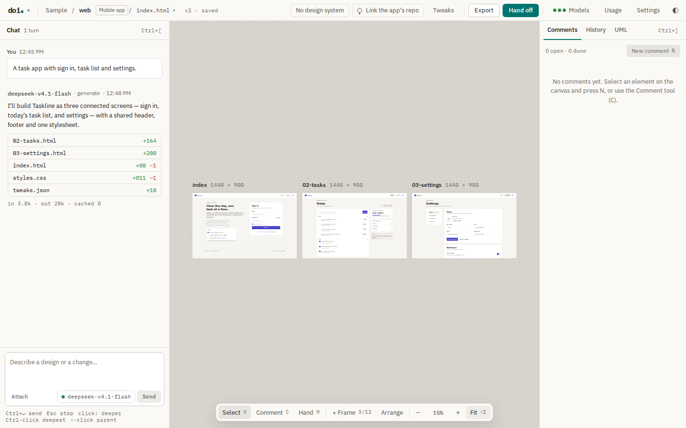

# doi

A local, single-user design tool in the style of Claude Design. You describe a design in chat, a model writes HTML and CSS, and a canvas shows it live. Any model provider can generate, and any coding agent can implement the result.



- **User guide:** [docs/user-guide.md](docs/user-guide.md): install, configuration, providers, the MCP setup, the workspace and the shortcuts.
- **Design doc:** https://claude.ai/code/artifact/4d202f6c-3105-4a19-8315-24b41aedf3ae
- **Agents that work on the repo:** start with [docs/agent-handoff.md](docs/agent-handoff.md).

## Status

In progress (M5, breadth). The core loop (M1), the precision tools (M2), design systems (M3) and the handoff (M4) work. See [docs/agent-handoff.md](docs/agent-handoff.md).

## Quick start

You need [Bun](https://bun.sh) 1.4.3 or later, `git`, and one model: the `claude` or `codex` CLI with a subscription, or an API key.

```bash
bun install
bun run install-browser              # optional: PNG and PDF export
cp config.example.toml config.toml   # optional
bun run start                        # http://127.0.0.1:4317
```

The first start makes `./workspace` with a sample design.

To run doi without Bun, build a binary with `bun run build` (Linux, macOS and Windows, in `dist/`). Start it with `doi --open`. See [The binary](docs/user-guide.md#the-binary) and [Start options](docs/user-guide.md#start-options).

The macOS work remains unmerged until the owner tests it on a Mac. Release v0.1.0 contains Linux and Windows binaries only. Use [the Mac test guide](docs/macos-testing.md) for the candidate.

By default, doi uses your subscription through the official CLIs: `claude-code:<model>` (`claude -p`) and `codex:<model>` (`codex exec`). Log in to the CLI first, or use the OAuth button in Settings. To use an API key, open Settings → Models and providers, select the provider, select API key, and paste the key. See [Providers and models](docs/user-guide.md#providers-and-models).

## Features

- Chat to make and change designs. Select an element to change only that element.
- Edit on the canvas: resize, move among siblings, nudge margins and align. Each change is one version.
- Comments on elements, and a full version history.
- Tweaks for the CSS variables of a design.
- Design systems from a repo or from screenshots.
- Export to a folder, one HTML file, PNG or PDF. Export and import projects as `.doi.zip`.
- Hand off to any coding agent through the MCP server at `/mcp`, or as a ZIP bundle.
- A link to the GitHub repo of your app, so the model can read its code.

## Hand off to a coding agent

Add the doi MCP server to your agent one time:

```bash
claude mcp add --transport http doi http://127.0.0.1:4317/mcp   # Claude Code
codex mcp add doi --url http://127.0.0.1:4317/mcp               # Codex
```

Then open Hand off (Ctrl/⌘ + Shift + H) in doi, copy the prompt, and paste it into the agent in the repo of your app. See [Hand off to a coding agent](docs/user-guide.md#hand-off-to-a-coding-agent-mcp).

## Check

```bash
bun test
bun check
```

## Layout

| Path | Contents |
| --- | --- |
| `src/server/` | `Bun.serve` routes, design file serving, bridge injection |
| `src/web/` | React UI (HTML import, no Vite): shell, chat, canvas, comments, history and the dialogs; tokens in `tokens.css` (doi UI kit, light and dark), IBM Plex bundled |
| `src/frame/bridge.js` | Script injected into each design iframe for selection and canvas edits |
| `src/providers/` | `Provider` interface, API adapters (Anthropic, OpenAI, OpenCode Go) and the CLI backends (Claude Code, Codex) |
| `src/generation/` | System prompts, context assembly, the edit applier, `data-oid` post-processing |
| `src/mcp/` | MCP server at `/mcp`: coding agents read designs through it |
| `src/handoff/`, `src/export/` | The agent prompt, the handoff bundle, HTML, PNG and PDF export |
| `src/workspace/` | Workspace layout, git history and safe path helpers |
| `test/` | `bun test` suites |
| `docs/` | The user guide, its screenshots and the agent handoff |
