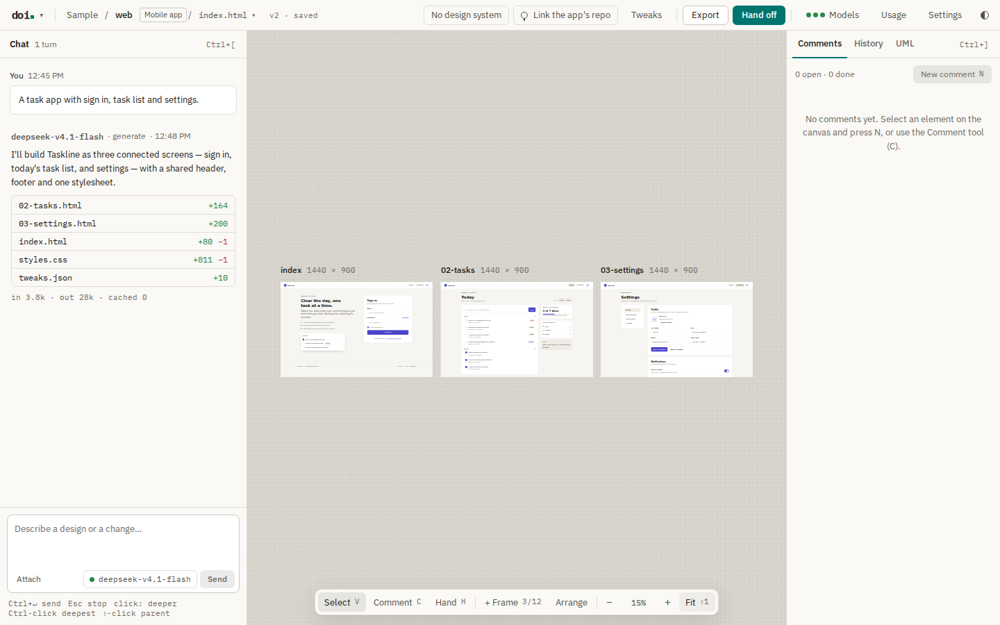
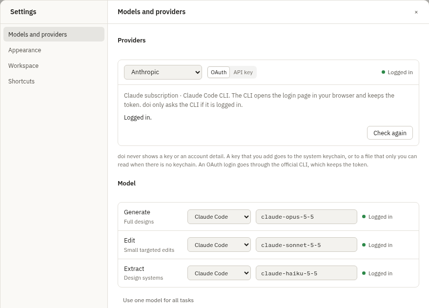
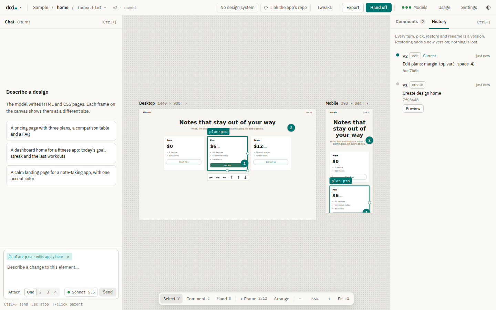
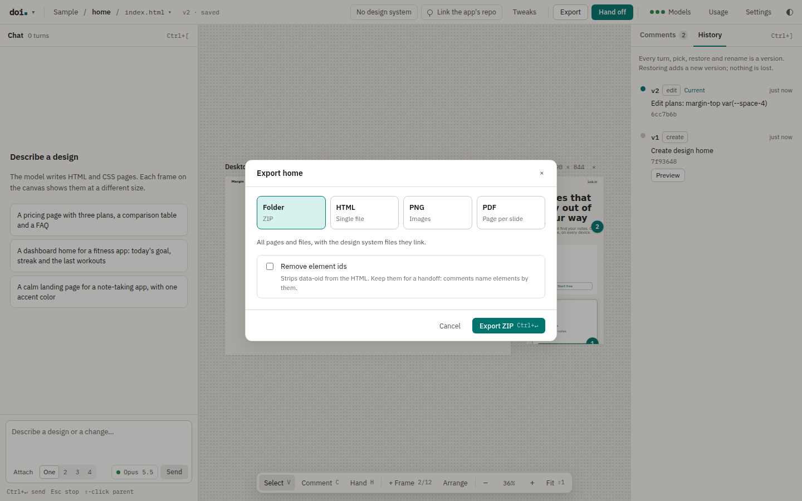
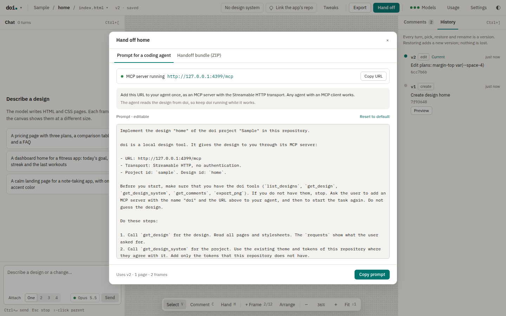

# doi user guide

doi is a local design tool for one person. You describe a design in chat. A model writes plain HTML and CSS. A canvas shows each page live, in one or more frames. A coding agent can then build the design in your app.

doi runs on your computer only. The server listens on `127.0.0.1`. Your designs, the chat and the version history stay in one folder, the workspace.



## Contents

1. [Install](#install)
2. [Configure](#configure)
3. [Providers and models](#providers-and-models)
4. [Make a design](#make-a-design)
5. [Edit on the canvas](#edit-on-the-canvas)
6. [Optional UML](#optional-uml)
7. [Comments and history](#comments-and-history)
8. [Design systems](#design-systems)
9. [Export](#export)
10. [Hand off to a coding agent (MCP)](#hand-off-to-a-coding-agent-mcp)
11. [The workspace](#the-workspace)
12. [Shortcuts](#shortcuts)
13. [Troubleshooting](#troubleshooting)

## Install

### Requirements

| Tool | Necessary | Used for |
| --- | --- | --- |
| [Bun](https://bun.sh) 1.4.3 or later | Only to run from the source or to build the binary | The server, the UI bundle and the tests |
| `git` | Yes | The version history of the workspace |
| `claude` (Claude Code CLI) or `codex` (Codex CLI) | One of them, or an API key | The model. See [Providers and models](#providers-and-models) |
| Chromium for Playwright | No | PNG and PDF export, and the screenshots in a handoff bundle |
| `gh` (GitHub CLI) | No | A link from a project to the GitHub repo of your app |

You can run doi as one binary, or from the source.

### The binary

The binary contains the server, the UI and the Bun runtime. It runs without Bun on Linux (x64, arm64) and macOS (arm64, x64).

1. Build the binaries on a computer with Bun. The binaries go to `dist/`, for example `dist/doi-0.1.0-linux-x64`:

   ```bash
   bun install
   bun run build                    # all four targets
   bun run build bun-darwin-arm64   # one target
   ```

2. Copy the binary for your system to a folder on your `PATH`, with the name `doi`.
3. Optional: install Chromium for PNG and PDF export:

   ```bash
   doi install-browser
   ```

4. Start doi:

   ```bash
   doi --open
   ```

The binary has no developer signature. If you download a macOS binary and Gatekeeper stops it, run `xattr -d com.apple.quarantine ./doi` one time.

### From the source

1. Get the code and install the packages:

   ```bash
   git clone https://github.com/zo-ll/doi.git
   cd doi
   bun install
   ```

2. Optional: install Chromium for PNG and PDF export:

   ```bash
   bun run install-browser
   ```

3. Optional: copy the example configuration. doi works without it.

   ```bash
   cp config.example.toml config.toml
   ```

4. Start doi:

   ```bash
   bun run start      # or: bun run dev (reloads when the source changes)
   ```

5. Open http://127.0.0.1:4317 in your browser.

On the first start, doi makes the folder `./workspace` with a git repository and a sample design.

### Start options

The binary and `bun run start` take the same options, for example `bun run start --port 5000`.

| Option | Description |
| --- | --- |
| `--config <file>` | The config file. The default is `config.toml` in the current folder |
| `--workspace <dir>` | The workspace folder. It replaces `workspace` from the config |
| `--port <n>` | The port on `127.0.0.1`. It replaces `port` from the config |
| `--open` | Open doi in the default browser after the start |
| `-v`, `--version` | Show the version |
| `-h`, `--help` | Show the help |
| `install-browser` | Install Chromium for PNG and PDF export, then stop |

## Configure

doi reads `config.toml` from the folder where you start it, or the file from `--config`. All keys are optional. A relative `workspace` path is relative to the folder of the config file. `config.example.toml` lists them with comments.

| Key | Default | Description |
| --- | --- | --- |
| `workspace` | `"./workspace"` | The folder for your projects, design systems and history |
| `port` | `4317` | The port of the server on `127.0.0.1` |
| `editor_url` | `"vscode://file{path}"` | The link that opens a design system file in your editor. doi puts the file path in `{path}` |
| `[providers.<id>]` | | Settings for one provider: `api_key_env`, `base_url`, `formats` |
| `[models]` | Claude Code models | The model for each task: `generate`, `edit`, `extract` |
| `[prices]` | | Prices in USD for each 1M tokens, for the usage report |

Settings (Ctrl/⌘ + ,) in the app writes only the `[models]` lines. The import of a `.doi.zip` file with its settings can also write the `[prices]` table. The other lines and your comments stay as they are. To change the prices, edit `config.toml`.

## Providers and models

A model reference has the form `provider:model`, for example `claude-code:claude-sonnet-5-5`. doi uses three tasks:

- `generate`: full designs and new pages.
- `edit`: a small change to one selected element.
- `extract`: the import of a design system. A screenshot import needs a model with vision.

### Subscriptions through the official CLIs

doi can use your subscription through the official CLI of the vendor. doi starts the CLI for each turn. You do not need an API key.

| Provider id | CLI | Log in |
| --- | --- | --- |
| `claude-code` | `claude -p` | `claude auth login`, or Settings → Models and providers → OAuth |
| `codex` | `codex exec` | `codex login`, or Settings → Models and providers → OAuth |

The OAuth button in Settings only starts the login command of the CLI. The CLI keeps the token. doi asks the CLI only if it is logged in. doi never reads or stores the token.

With `codex:default`, Codex uses the model from your Codex configuration.

### API keys

| Provider id | Default variable | Notes |
| --- | --- | --- |
| `anthropic` | `ANTHROPIC_API_KEY` | Anthropic API |
| `openai` | `OPENAI_API_KEY` | OpenAI Responses API |
| `opencode-go` | `OPENCODE_API_KEY` | OpenCode Go. Set `formats` in `config.toml` for a model that doi does not know |

You can give a key in two ways:

- Set the environment variable. `api_key_env` in `config.toml` can name a different variable.
- Open Settings → Models and providers, select the provider, select API key, and paste the key. doi keeps the key in the system keychain. If there is no keychain, doi keeps it in `~/.config/doi/credentials.json` (mode 0600).

If both exist, the environment variable wins. doi never shows a key in the UI.

The ids `google`, `openrouter` and `ollama` are reserved for adapters that are not available yet.

Use only the provider ids in this section for `[providers.<id>]` tables. An unknown id stops doi before the server starts. The error names the config file and the unknown id.



### Usage and cost

Usage (top bar) shows the tokens of each answer. For an API model with an entry in `[prices]`, it also shows an estimated cost. A subscription shows tokens only.

**Warning:** Usage omits variants that older versions of doi made and that you did not pick. For such a design, its token totals and cost estimates can be lower than actual use.

## Make a design

1. Open the projects drawer (the doi logo, or Ctrl/⌘ + P). Make a project, then a design, a mobile app or a slide deck.
2. Type a description in the chat on the left, and send it with Ctrl/⌘ + Enter.
3. The model makes what the request needs. A request for one thing, for example a card, makes one page. A request for a product or a flow makes one linked page for each screen, up to 12 (24 in a mobile app). The canvas shows a single page in a Desktop and a Mobile frame, and several pages in one Desktop frame each.
4. Send more messages to change the design. Each completed turn is a new version.

If a request does not say enough, or if the model can read it as much more or much less than you want, the model asks first. The chat shows its questions with options and a field for your own answer. Select an option or write an answer, then select Send answer. You choose lets the model make the choices. The model is told to change no file in a turn with questions; doi does not check this.

To rename a design, use its Rename control in the projects drawer. F2 also starts a rename when the design has focus.

You can attach images to a message (Attach), for example a sketch or a screenshot.

The canvas has three tools:

- Select (V): click to select, as in Figma. The first click selects the outermost element under the pointer. Each click inside the selection selects one level deeper. A click elsewhere selects at the level where the click and the selection meet (for example a sibling). Ctrl/⌘-click selects the deepest element at once. Shift-click selects the parent. The hover outline shows what a click selects.
- Comment (C): click an element to add a comment to it. The comment goes to the deepest element under the pointer.
- Hand (H): move the canvas.

"+ Frame" (F) adds a frame size. "Arrange" puts the frames in a row. The zoom controls are at the bottom.

### Mobile apps

A mobile app shows each page of the design as one phone screen (390 × 844), side by side, as in Figma. Make one with "+ Mobile app" in the projects drawer, or click "Mobile app" next to the design name in the top bar to show an existing design that way (click it again to go back). Ask the chat for more screens, for example "add a screen with the file list": the model writes each screen as a new page. "+ Screen" (F) adds an empty screen that you can then describe in the chat. A click in a screen selects in that screen's page.

When an element is selected, your next message changes only that element. doi uses the `edit` model for it. The chip above the message box shows the selected element. Click × on the chip (or press Esc) to clear the selection, for example before you ask for new screens or pages.

Every meaningful element in a design has a `data-oid` attribute. Selection, comments and edits use it. doi adds missing ids after each turn.

## Edit on the canvas

A design with one page shows a Desktop frame and a Mobile frame. A design with several pages shows one Desktop frame for each page, in page order. A click in a frame opens that page. Drag a frame label to move the frame. doi keeps the place. "+ Frame" adds a frame at another size, for example Mobile. That frame shows the open page. A design shows at most 12 frames. Open the other pages with the page picker in the top bar.

With the Select tool, you can change the selected element directly. doi writes each change as CSS in a `[data-oid="…"]` rule at the end of `styles.css`, or moves the element in the HTML. Each change is one version.

- **Resize:** drag a handle on the right edge, the bottom edge or the corner. The size snaps to the spacing unit.
- **Move:** drag the tag label of the element. A line shows where the element goes among its siblings.
- **Margins:** hold Alt and drag the tag label. The margins snap to the spacing scale.
- **Align:** use the bar under the element: start, center or end, horizontal or vertical.
- **Undo:** Ctrl/⌘ + Z undoes the last edit as a new version.

The spacing scale comes from the `--space-*`, `--spacing-*` and `--gap-*` variables on `:root`. If there are none, doi uses a 4 px scale.

An edit applies to all frames. A more specific rule in the design can still win over the edit rule. An element moves only among its siblings, not into a different parent.

### Node links

Each selected element has a link, as in Figma. The side panel shows it above Comments and History, with "Copy link". The address bar shows the same link. Open the link to open the design and the page with that element selected. Give the link to a coding agent: the MCP tool `get_element` reads the element from it.

Under the link, the CSS block shows the CSS rules that match the element, each with its file (for example `styles.css`) and its `@media` rule, and the element's `style` attribute. "Copy CSS" copies them.

### Tweaks

Tweaks (T) shows controls for the CSS variables of the design, for example colors and sizes. The canvas changes live. "Save as version" writes the values.

## Optional UML

UML is optional for each project. The first editor supports real boxes, class compartments, connectors, properties and UI links. It uses the app's current theme.

UML saves your edits automatically, about one second after you stop. The header shows the state: **Saving…**, **Saved**, **Unsaved changes** or **Not saved**.

1. Open a project.
2. Select **UML** in the right panel.
3. Select **Add UML to this project**.
4. Use **+ Shape** to add an item.
5. Drag between the handles to connect two items.
6. Select an item to edit its properties in the right panel.
7. Optional: select **Save diagram**, or press Ctrl/⌘S, to save at once and record a version.

The connector inspector has relationship presets, labels, markers, routes and attachment controls. A box can link to a UI design, page or node. **Back to UI design** returns to the normal design canvas. Chat sends UI requests only; the composer is disabled while a UML diagram owns the canvas.

### Arrange a diagram

Select several items with Shift-click, Ctrl/⌘A or a drag on the empty canvas. The **Arrange** menu has these tools:

- **Align**: left, centres, right, top, middles or bottom. Select two or more boxes. A box inside a selected group moves with its group, so a group and its own boxes count as one.
- **Distribute**: equal gaps, horizontally or vertically. Select three or more boxes.
- **Order**: bring to front, bring forward, send backward or send to back. Groups always draw behind other boxes.
- **Group**: put the selected boxes into a new group, or ungroup a group. The boxes keep their positions and connectors. A group can be at most 4096 px wide and high. Remove the connectors of a group before you ungroup it.
- **Lock** and **Unlock**: a locked item does not move, resize, change order or get cut. A cut of a group also stops when a box in the group is locked. Unlock it first.

| Shortcut | Action |
| --- | --- |
| Arrow keys | Move the selected boxes 1 px. Hold Shift to move 16 px. |
| Ctrl/⌘C, Ctrl/⌘X, Ctrl/⌘V | Copy, cut and paste boxes and the connectors between them. A paste gives the copies new ids. |
| Ctrl/⌘D | Duplicate the selected boxes. With no box selected, Ctrl/⌘D opens the design systems, as elsewhere in doi. |
| Ctrl/⌘G, Ctrl/⌘Shift+G | Group, ungroup. |
| Ctrl/⌘Z, Ctrl/⌘Shift+Z | Undo, redo. |
| Delete | Delete the selection. |
| Esc | Close an open menu, or clear the selection. |

The shortcuts work when the focus is in the diagram or on the page, not in a text field or a dialog. When you select text with the mouse, Ctrl/⌘C copies that text, not the diagram items. Copy uses the system clipboard, so you can paste into another diagram or another doi window.

When **Snap** is on and you drag one box, a line shows where an edge or the centre meets the same line of another box in the same group, or where the two boxes touch. The box snaps to that line. **Snap** also snaps positions to the 16 px grid. **Fit all** shows the whole diagram; **Fit selection** zooms to the selected boxes.

**Hide UML** keeps saved diagrams. **Show UML in this project** restores the area. Rename, duplicate and delete controls appear in each diagram's menu.

**Export JSON** saves an editable diagram. **Import JSON** adds a diagram to the current project. If the project already has a diagram with the same name, the import adds " copy" to the name. If a save conflict occurs, export your edits before **Load latest**. You can then import that file as another diagram.

### Autosave and versions

Autosave does not stop you: you can continue to edit while a save runs, and the next autosave stores those edits.

- **Not saved: changed elsewhere**: another window or an agent saved the diagram first. Autosave stops and keeps your edits. Export JSON to keep a copy, then select **Load latest**.
- **Not saved**: a value breaks a rule, for example an empty box name. The notice names the field. Autosave starts again after your next edit.
- **← Back to UI design** saves the last edits first. If they cannot be saved, doi asks before it discards them.

doi records a version of the project's diagrams in its history when you select **Save diagram**, when you leave a diagram inside doi, and every 5 minutes while autosave runs. A browser reload or a closed tab keeps the autosaved edits, but records no version. Versions need git in the workspace: if git does not accept the UML file, doi says so once, and saves still work. The History tab lists the saved versions, newest first. **Restore** puts the open diagram back as it was in that version. The restore is an ordinary edit: **Undo** reverses it, and autosave stores it. Before a restore, doi saves your edits and records the current state as a version, so no saved state is lost.

### Export an image

Open **Export image** in the diagram toolbar.

1. Choose the **Format**: SVG, PNG or PDF.
2. Choose the **Scope**: the whole diagram, or the selected boxes. A selected group includes its boxes. Connectors between the exported boxes come too.
3. Choose the **Colours**: dark or light. The default follows the app theme.
4. Clear **Background** for a transparent SVG or PNG. A PDF without a background has a white page.
5. For PNG, choose the **Size**: 1× or 2×.
6. Select **Download**.

The export uses the diagram as you see it, also before autosave stores it. The doi server makes the file. SVG files contain the app's IBM Plex fonts for the text that the image draws: IBM Plex Sans for Latin, Latin extended, Cyrillic, Greek and Vietnamese, and IBM Plex Mono for the same scripts except Greek. This text looks the same in other tools. Other text, for example Chinese or Greek class attributes, uses a font of the computer, as in the app. PNG and PDF need Chromium for Playwright on the doi computer, the same as the design exports; without it, the export says how to install it. An image can be at most 16 000 px on a side and 64 million pixels: export a selection, use 1× or use SVG for a larger diagram.

### Agents and UML

A coding agent reads the diagrams through the doi MCP server (`get_architecture`, `render_architecture`). It can also change a diagram with `update_architecture`, with the same checks as the editor. The agent can do this only in a project where you added UML.

- An open diagram shows the agent's change at once. **Undo** reverses it.
- If you have edits that are not saved yet, doi keeps them and stops autosave with **Not saved: changed elsewhere**. Export JSON to keep your edits, then select **Load latest**.
- doi records each agent change as a version in the History tab.

The handoff includes the diagrams when the project uses UML: the agent prompt asks the agent to read them, and the handoff bundle has `architecture/architecture.json`, one SVG for each diagram that has boxes, and the open diagram comments in `HANDOFF.md`. A handoff of a project without UML has no architecture part.

**Important:** Run only one doi process for a workspace. The save lock for diagrams is inside one process. Two doi processes on the same workspace can both write a diagram, and the last write wins.

## Comments and history

### Comments

Select an element and press N, or use the Comment tool (C). The Comments tab on the right lists the comments, and the canvas shows a pin on each element.

- Apply puts a comment into your next message.
- Done marks a comment as complete. When a turn includes an applied comment and changes its element, doi marks that comment as done.

### History

The History tab lists the versions of the design. Every turn, edit, restore and rename is a version. A "pick" is a version from an older doi that had variants. Preview shows an old version on the canvas. Restore makes the old version the current one, as a new version. No version is lost.



## Design systems

A design system gives the model your tokens, components and rules. Open Design system (Ctrl/⌘ + D) in the top bar.

- **Import from a repo:** give the path of a local repo. doi reads its theme files, token files, stylesheets and main components, and the `extract` model writes the design system. doi does not read files that look like secrets.
- **Import from screenshots:** give 1 to 5 screenshots and optional notes. The `extract` model needs vision.
- **Use for a project:** select "Use in <project>". The pages of the project then link the tokens and component styles of the design system.

A design system is a folder in `design-systems/<name>/` with these optional files: `tokens.css`, `components.html`, `components.css`, `rules.md`, `fonts/` and `screenshots/`. You can edit them in your editor.

### The code of your app

A project can link the GitHub repo of your app. Click "Link the app's repo" in the top bar. You must install `gh` and log in with `gh auth login` first. doi keeps a shallow clone in `<workspace>/.repos/`. The model can then read the code of your app, so you can ask, for example, "Recreate the settings page". Turns with a linked repo read more code, so they use more tokens.

## Export

Open Export (Ctrl/⌘ + E).

| Format | Result |
| --- | --- |
| Folder | A ZIP with all pages and files, and the design system files that they link |
| HTML | One HTML file with the styles, scripts, images and fonts inline |
| PNG | An image of one frame, or a ZIP with all frames |
| PDF | One PDF page for each slide of a deck, or one page for other designs |

"Remove element ids" strips the `data-oid` attributes from the HTML. Keep them for a handoff, because comments name the elements by their ids.

PNG and PDF need Chromium. Run `doi install-browser` (from the source: `bun run install-browser`) one time.



### Projects and the workspace

You can export one project (projects drawer → Export) or the full workspace (Settings → Workspace) to a `.doi.zip` file. The file contains the version history. It can also contain the model choice, the prices and the UI preferences. Import the file in any doi workspace.

## Hand off to a coding agent (MCP)

doi does not start coding agents. Any coding agent with an MCP client reads the design from doi through the MCP server of doi. The server is at `/mcp` on the doi server, for example `http://127.0.0.1:4317/mcp`. It uses the Streamable HTTP transport and has no authentication. It accepts only requests from your computer.

### Add the MCP server to your agent

Do this one time for each agent. Use the URL that Hand off shows. It contains the port from `config.toml`.

- Claude Code:

  ```bash
  claude mcp add --transport http doi http://127.0.0.1:4317/mcp
  ```

- Codex:

  ```bash
  codex mcp add doi --url http://127.0.0.1:4317/mcp
  ```

- Other agents: add an MCP server with the name `doi`, the transport Streamable HTTP, and the URL above. Refer to the documentation of your agent.

The agent reads the design from doi while it works. Keep doi running until the agent stops.

### The MCP tools

| Tool | Result |
| --- | --- |
| `list_designs` | The projects and their designs |
| `get_design` | The files of a design, its pages, frames, design system name and the last requests |
| `get_architecture` | The optional UML state, saved diagrams, stable item ids, UI references and current revision of a project |
| `render_architecture` | An image of one UML diagram |
| `update_architecture` | Creates or replaces one UML diagram, with the editor's checks and the revision from `get_architecture`. Only in a project with UML |
| `get_design_system` | The tokens, components and rules of the design system of a project |
| `get_comments` | The open comments of a design (with `all`: the done comments too) |
| `get_element` | One element by its `data-oid`, as the browser renders it in one frame: HTML, box, computed styles, matching CSS rules, ancestors and children |
| `export_png` | An image of one page in one frame |

### Give the task to the agent

1. Open Hand off (Ctrl/⌘ + Shift + H).
2. Edit the prompt if necessary, and click Copy prompt.
3. Start your agent in the repo of your app, and paste the prompt.

The prompt tells the agent to read the design through the tools, to use the framework and components of your repo, and to run the checks of your repo.

For an agent that cannot reach doi, for example an agent in the cloud, use the "Handoff bundle (ZIP)" tab. The bundle contains a `HANDOFF.md` file, the design files, screenshots of each page and frame, `tokens.css` when the design or its design system has tokens, and the UML diagrams in `architecture/` when the project uses UML.



## The workspace

The workspace is a git repository. doi commits each change with your own git identity. You can read the history with `git log`.

```text
workspace/
├── projects/
│   └── <project>/
│       ├── project.json          # name, layouts (the frames), design system, linked repo
│       ├── chat.jsonl            # one line for each chat message
│       ├── designs/
│       │   └── <design>/
│       │       ├── index.html    # the pages (more .html files are more pages)
│       │       ├── styles.css
│       │       ├── tweaks.json   # optional: the Tweaks controls
│       │       └── .comments.json
│       └── uploads/              # images that you attached to messages
├── design-systems/
│   └── <name>/                   # tokens.css, components.html, components.css, rules.md, fonts/, screenshots/
└── .repos/<owner>/<repo>/        # clones of linked app repos (not in the history)
```

A design is plain HTML and CSS. You can open it in your editor. doi reloads the canvas when a file changes. If you edit a file yourself, commit the change in the workspace, or the next doi change can include it.

## Shortcuts

On macOS, use ⌘ in place of Ctrl.

| Action | Keys |
| --- | --- |
| Projects | Ctrl + P |
| Collapse the chat / the side panel | Ctrl + [ / Ctrl + ] |
| Design system | Ctrl + D |
| Export / Hand off | Ctrl + E / Ctrl + Shift + H |
| Settings | Ctrl + , |
| Select / Comment / Hand tool | V / C / H |
| New comment on the selection | N |
| Add a frame | F |
| Tweaks | T |
| Zoom in / out / 100% / fit | + / − / 0 / Shift + 1 |
| Send / stop | Ctrl + Enter / Esc |
| Undo the last canvas edit | Ctrl + Z |
| Select one level deeper | Click again |
| Select the deepest element | Ctrl-click (⌘-click on macOS) |
| Select the parent element | Shift-click |

Settings → Shortcuts shows the same list without Ctrl + Z.

## Troubleshooting

- **The model status is not green.** Open Settings → Models and providers. Log in to the CLI, or add an API key. "Check again" reads the status again.
- **"Another change runs on this design".** A turn, a rename or an edit is in progress on the design. Wait until it stops, and then try again.
- **PNG or PDF export gives an error (503).** Chromium is not installed. Run `doi install-browser`, or `bun run install-browser` from the source.
- **The agent does not have the doi tools.** Add the MCP server (see [Hand off](#hand-off-to-a-coding-agent-mcp)), make sure that doi runs, and start the agent again.
- **The port is in use.** Set a different `port` in `config.toml`.
